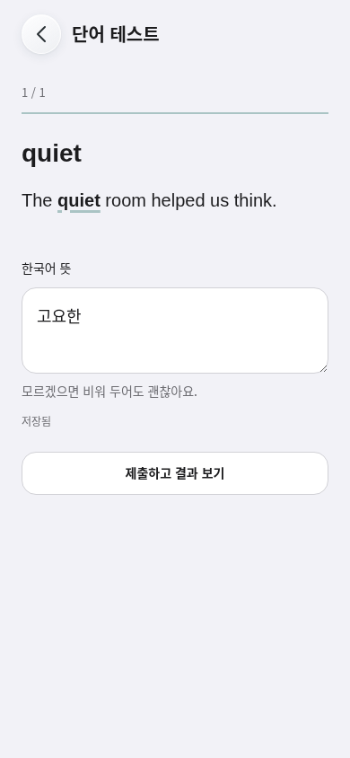
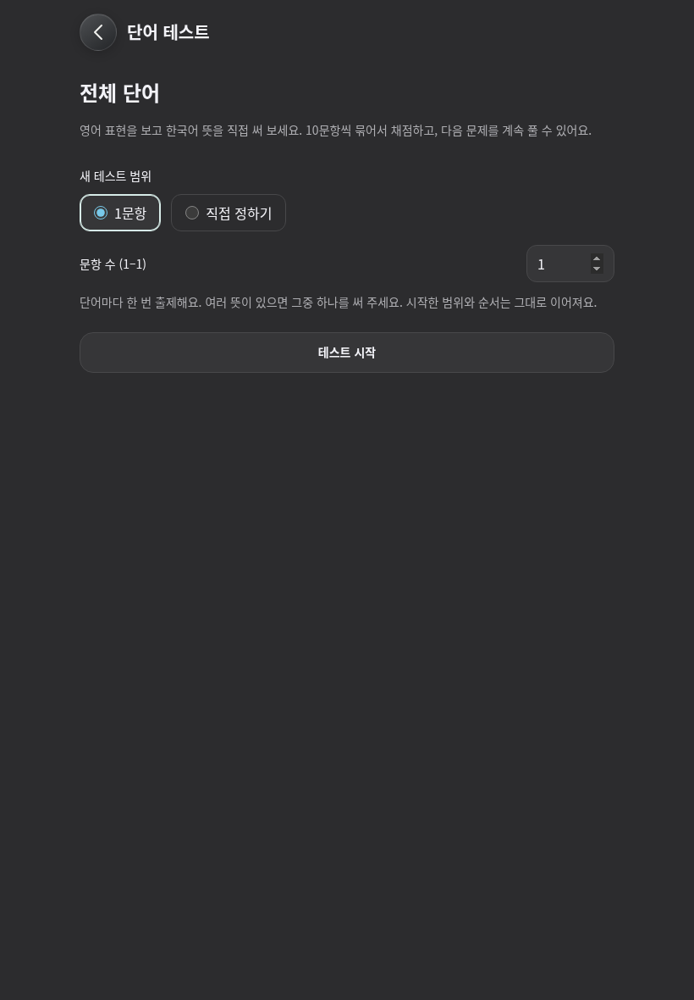
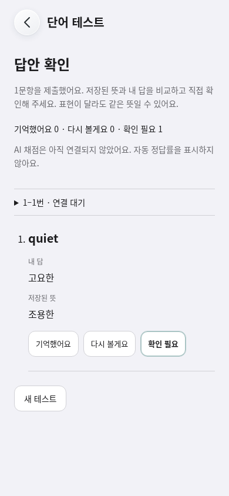
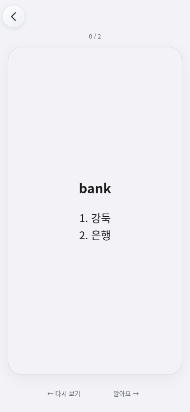

# Vocabulary test prototype review

Base: `5f8b178e45727948690c0ce52d1e5f0a30362544` (main).
Feature branch: `feat/vocabulary-test-astra`. Native version/build remains 1.9.3
(272); no native project, protected branch or deployment change.

The prototype asks for one Korean meaning, samples unique words without
replacement, persists the frozen order and draft, and reviews ten-answer batches
while the next question stays editable. Multi-sense words appear once in new
sessions, omit examples, and show all saved meanings as numbered lines after
reveal. Legacy running sessions retain their existing history. Test outcomes are
stored separately from learned progress and review records.

## Evidence

These are actual Chromium app screenshots using synthetic local vocabulary.
The shipped remote grader is disabled. Correct/incorrect semantics in adapter
checks are **local mock responses**, not live model quality results.

| Question / iPhone size | Setup / iPad size, dark |
| --- | --- |
|  |  |

| Pending result review | Revealed multi-meaning study card |
| --- | --- |
|  |  |

`browser-metrics.json` records 2,000 and 12,000-word sampling plus a full
12,000-word test. The question screen mounted 19 nodes. These local timings are
observations, not a device performance guarantee. `direction-events.json` records
actual reveal, short drag cancellation, both committed directions, repeat return,
tappable labels, keyboard activation and reduced-motion completion. The review
video is the direct Playwright recording, converted to MP4 with FFmpeg; no frames
were generated or reconstructed.

## Validation scope

- `npm test`: existing broad repository suite passed.
- Focused test/core/storage/SQL/learning suite: 182 tests passed.
- Chromium vocabulary test: empty/count bounds, 1/11/tail batches, frozen random
  order, draft reload, injected quota failure, late responses, duplicate claims,
  source-deleted saved set, 2k/12k scope, bounded DOM and result isolation passed.
- Chromium layouts: 390×844, 820×1180, 1440×900, 320×568, 844×390,
  390×380, light/dark. The short viewport approximates available keyboard space;
  it is **not** native iOS keyboard testing. Input fonts are ≥16 px, Enter does not
  submit an IME composition, zoom is allowed, focus and ≥44 px actions checked.
- Existing simple cards and saved-set browser regression passed, including
  reload/offline, storage retry, row gestures, focus and navigation. Direction
  regression passed in both learning paths, including reduced motion.
- Typecheck retains its pre-existing 32 diagnostics; no increase. Diff check and
  native/version diff checks pass.
- **Expected failure:** `verify-193-build272-boundary.mjs` rejects new feature
  paths because it pins the historical 272 submission tree. It is unchanged.
  The dedicated Vocabulary test workflow runs the new feature independently.
- **Not run/verified:** local WebKit (Playwright CDN 403), physical iPhone/iPad
  keyboards, VoiceOver, native build/device performance, actual OpenRouter grading
  quality, production SQL/RLS deployment and production Edge integration.

No paid calls, real vocabulary transfer, schema deployment, merge or TestFlight
upload took place. Both remote gates remain false. Before live grading, review
consent, semantic rubric calibration, quota/cost, the proposed receipt migration
and retention policy. The live payload/model/cost details are in
[decision 031](../../decisions/031-vocabulary-test.md).

## Final review delivery

[Download the actual 24-second study-direction recording](breeze-study-directions.mp4).
The Library upload attempt returned `transfer_failed` for all five files;
no Library item or Library ID was finalized. The MP4 and screenshots remain
available in this PR, so the failed upload does not prevent visual review.

At `03b61b0`, the dedicated [Vocabulary test workflow](https://github.com/MetroBummin/breeze/actions/runs/38342643807)
passed local contracts and both Chromium/WebKit browser jobs. The existing full
`npm test`, focused 182 tests and all four local Chromium suites also passed.
One simultaneous npm/browser run timed out (6 s) while returning from the
12k test to the pre-existing Memory list; the unchanged commit's standalone
browser rerun and both CI engines passed. This timing incident is not a claim
of physical-device responsiveness.
