# Post-270 row and gesture review

Implementation follows shipped `f34cef95f4cec5835e60dfc7ca831d7020e75c7f`.
These are browser reproductions and measurements, not physical iOS acceptance.
The supplied private Library screenshot could not be downloaded with the current
official helper, including one supported retry. Its pixels were not inspected or
included here. The synthetic inventory reproduces its reported 2,294 words /
2,399 meaning cards using authored data.

## Results and causes

All Words used the shared `createVocabularyGroup` markup but omitted the
`.vocabulary-rows` scope from its list. This bypassed the shared wordbook grid,
ordinal and chip rules: the old first word began at x125 and its 92px-wide chip
wrapped below at x22. The fixed word begins at x30, with a 44px chip at x316 in
the same row. Meanings/examples remain readonly and no rating write, exclusion
or deletion handler is added. Phone/tablet/desktop/short/narrow in both themes
assert compact grid, header and fixed Start bounds, zero window scroll and the
2,294 group count. Raw measurements are in `study-layout.json`.

| Shipped source | Current source |
| --- | --- |
| 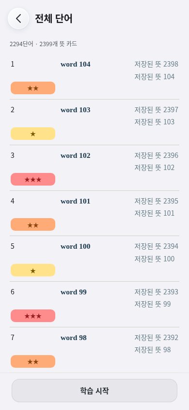 | 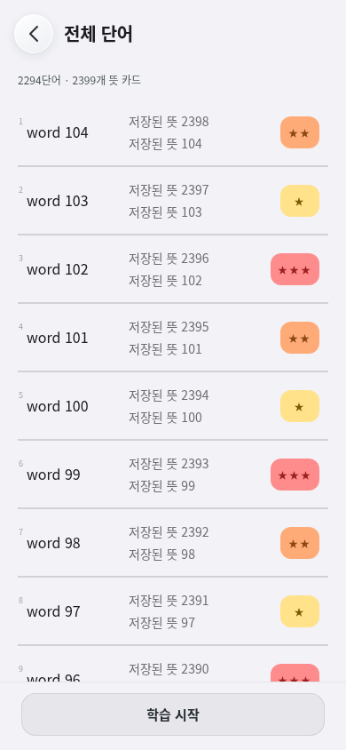 |

Study's old set handler reset the outgoing transform before asynchronous durable
grade completion. A held commit reproduces the old text returning to x20 at the
center. All Words also cleared the gesture before its save and reused a card
with a transform transition, allowing new text to inherit return movement.
Shared presentation now tracks direct input, uses recent release velocity,
rejects an opposite final trajectory and requires 36px of intentional horizontal
travel before accepting a projected flick. Cancellation uses an interruptible
spring; pointerdown freezes its actual current position. The departing card
remains outside the viewport through the durable write; next content is rendered
without an inherited return transform. The underlying surface contains no second
text layer. Normal saves overlap the brief exit. An intentionally held write
keeps the neutral surface visible rather than returning stale text.

Custom-set exclusion uses the same spring and velocity measurement, retains its
parked action, and serializes independent row releases during a pending write.
Each queued row retains its navigation owner and rereads durable state. Repeat
input on a pending row cannot duplicate the mutation. Undo and neighboring row
pointer capture survive the exit/collapse. Vertical and canceled gestures do not
exclude or grade. Again goes to the queue tail and never increments progress.

Set-detail ellipsis alone changes from 2px to 2.3px filled dots. The existing
24px frame, 44px circle, Back icon and paired shell material are unchanged.
The app-family fixture carries only this explicit optical exception.

## Actual motion frames

The paired capture serves the exact shipped set UI/CSS for Before, and the
working source for After. It holds only the durable commit. No animation clock
is sought or slowed. `handoff-paired.json` records real rAF positions and capture
timestamps. Captures below are ordered actual frames, not interpolated images.

| Phase | Finger drag | Early exit | Commit deliberately held | Next front |
| --- | --- | --- | --- | --- |
| Shipped | 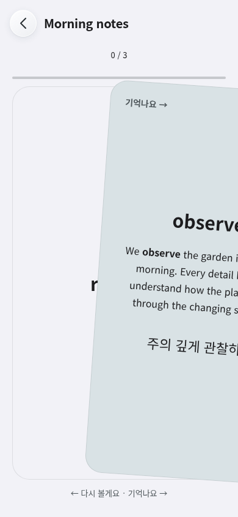 | 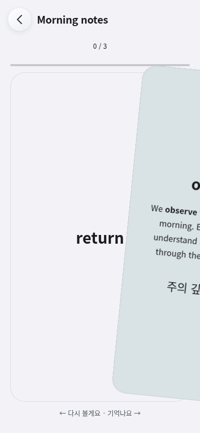 | 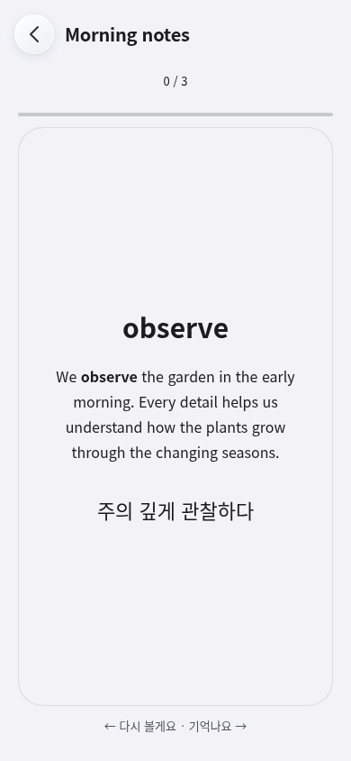 | 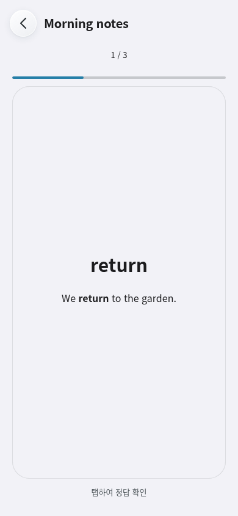 |
| Current | 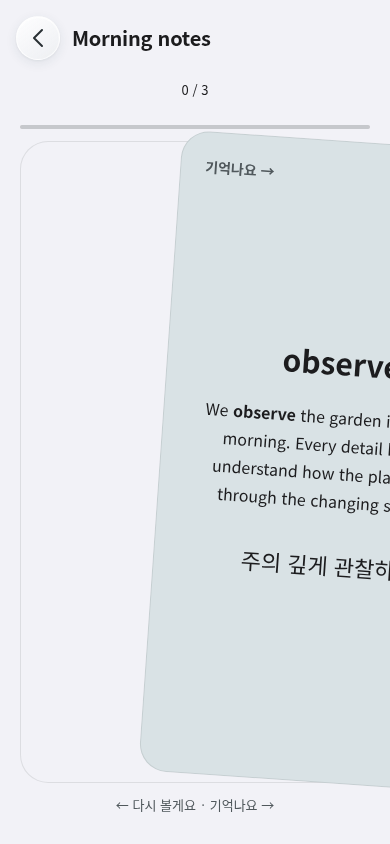 | 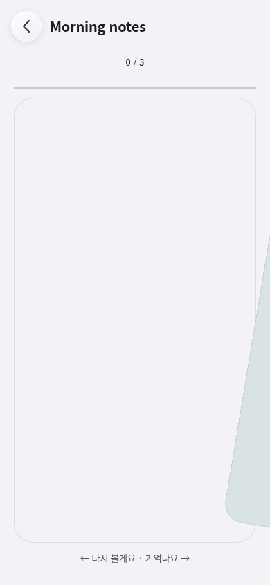 | 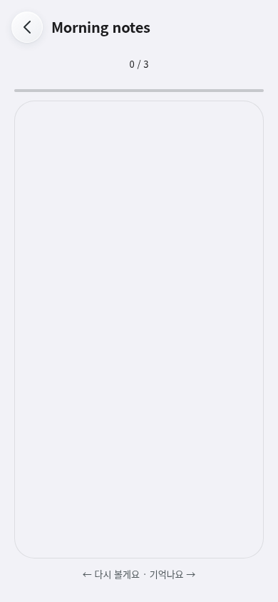 |  |

Videos: [shipped handoff](handoff-before.webm), [current handoff](handoff-after.webm),
[full study/row input regression](study-chromium.webm),
[pinch and interruption regression](pinch-chromium.webm).

PDF under-min elasticity remains presentation-only. A damped 460ms compositor
spring has one small overshoot; scale/scroll/page queries stay at their committed
minimum. A re-grab acquires the actual displayed matrix, including translation
at a different midpoint and the tiny overshoot. A held pair does not drift, and
stale return completion cannot cancel the new owner. Existing native scroll,
lookup and annotation owners settle presentation before sampling their geometry.
One-finger scrolling interrupts the return. Reduced motion settles immediately.

| Minimum | Held under minimum | Return | Settled |
| --- | --- | --- | --- |
| 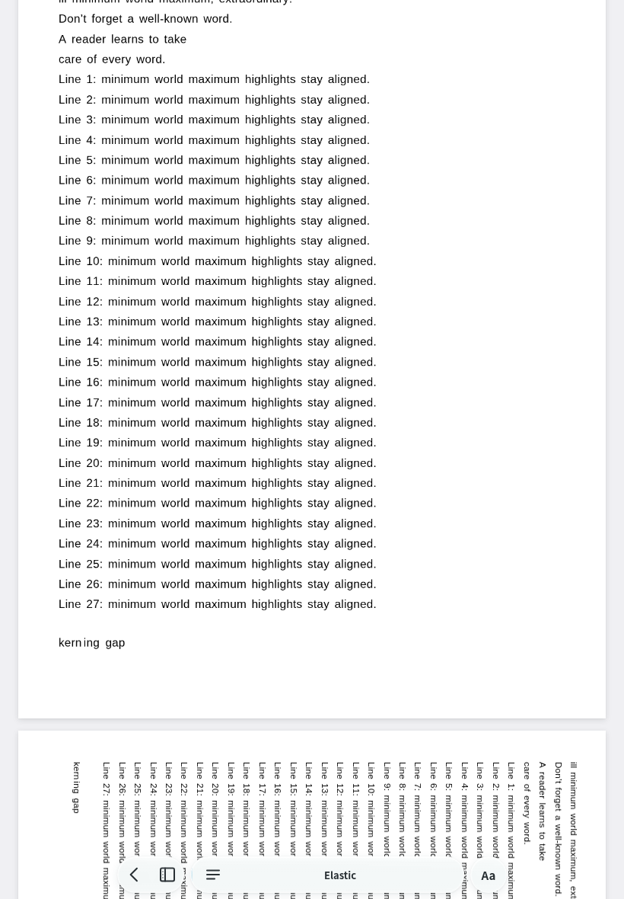 | 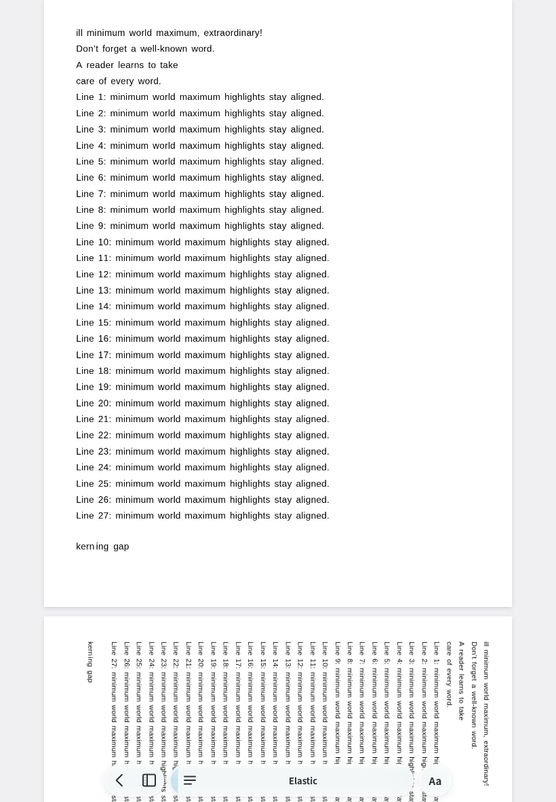 | 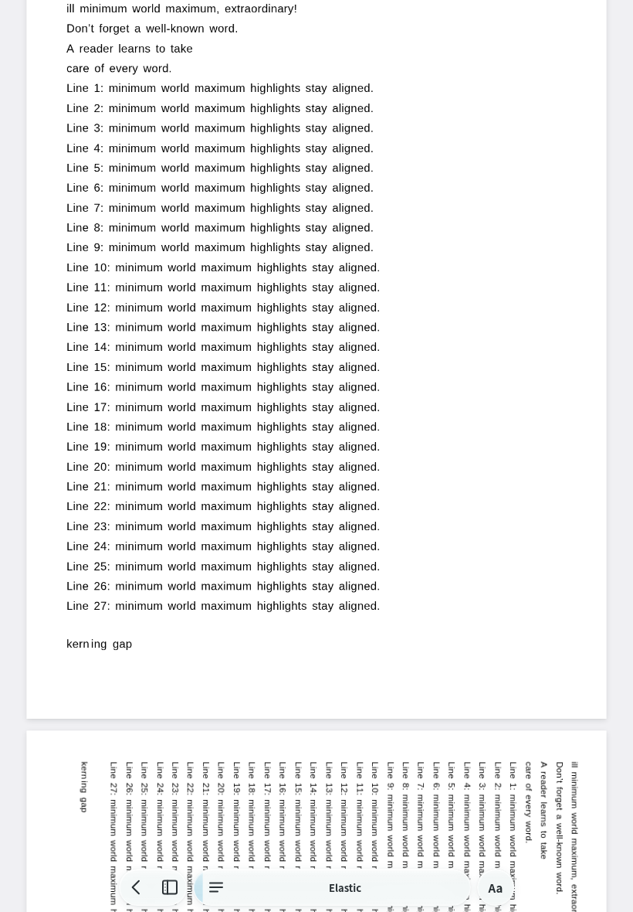 | 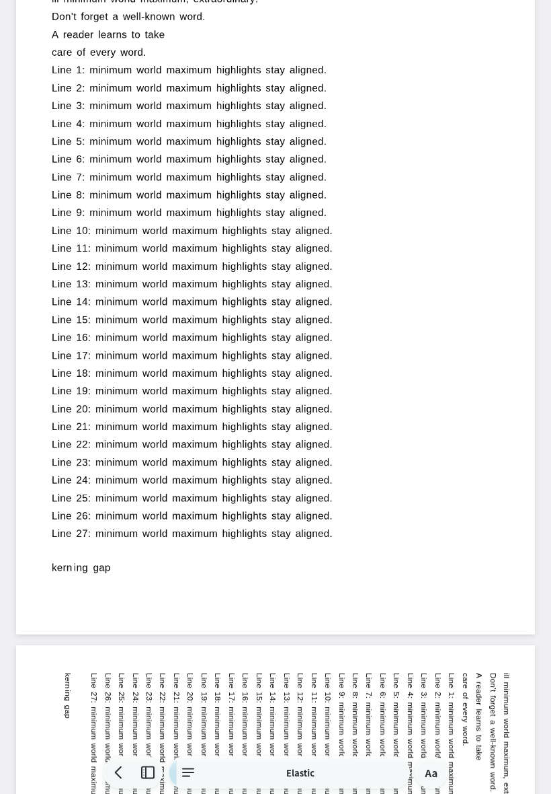 |

`pinch-motion.json` records scale/translation/scroll per frame, full-matrix
re-grabs below minimum and during overshoot, and rotation at page 2, normalized
y≈0.29949. Rotation changed the source point by about 0.092 CSS px; rotating
back restored the original normalized point. The regression requires the same
page and no more than 1.5 CSS px of scroll rounding.

## Validation

Local Chromium, `/usr/bin/chromium`, with the ordinary application scripts:

- New study motion regression: trusted CDP touch, readonly 2,294/2,399 inventory,
  ten bounded layouts, long stored examples/flipped cards, velocity reversal,
  held/re-grabbed spring, two row releases while a write is held, delayed handoff,
  intentional short flick, three consecutive distinct repeat tokens, no extra
  progress, vertical ownership, reduced motion and leave/reopen during commit.
- New PDF motion regression: trusted CDP plus deterministic direct-owner matrix
  probes; under-min preview, restrained overshoot, unchanged committed geometry,
  changed-midpoint re-grab, held preview, stale completion, five repeated pinches,
  cancellation, source-anchor rotation, reduced motion and scroll interruption.
- Existing study-session swipe suite: ten layouts, long content and queue rules.
- Existing study-sets trusted touch suite: exclusion/Undo, menu and responsive UI.
- Existing simple-word cards: empty/one/2,400, persistence and ten layouts.
- Existing PDF pinch: three Chromium sizes, 12 cycles each, 120-page fixture,
  focal/scroll preservation, lookup and cancellation. The re-grab endpoint now
  derives from the acquired live raw scale ×1.3, instead of assuming a snap to1.
  Existing min/max, anchor and ownership assertions remain.
- Existing PDF interruption suite: native-offset race and missing/stale endings.
- Existing header equality suite and complete app icon-family capture passed.
- Study DOM contracts: all 40 tests pass using the actual new motion owner.
  Coordinate-only Node events use a fixed clock; real timing belongs to browser
  velocity tests. No assertion was dropped.
- Typecheck retains the existing 32 diagnostics. Parent ran aggregate `npm test`
  successfully; final native sync and CI/release gates are parent-owned.

Reproduce new checks with `BREEZE_BROWSER_EXECUTABLE=/usr/bin/chromium` where a
system Chromium is needed and `BREEZE_MOTION_OUTPUT=/tmp/breeze-motion-proof`:

```
node tests/verify-study-motion-browser.mjs
node tests/verify-pdf-elastic-motion-browser.mjs
node tests/capture-study-handoff-browser.mjs
```

Both new regression scripts support `BROWSER=webkit`. That route uses synthetic
pointer/touch events and is labeled accordingly. Local WebKit download is
blocked; actual WebKit CI, native physical scrolling/annotation coexistence,
120Hz feel and physical pinch acceptance remain unverified. Onboarding clips,
front example content, other icons and release counters are preserved.
