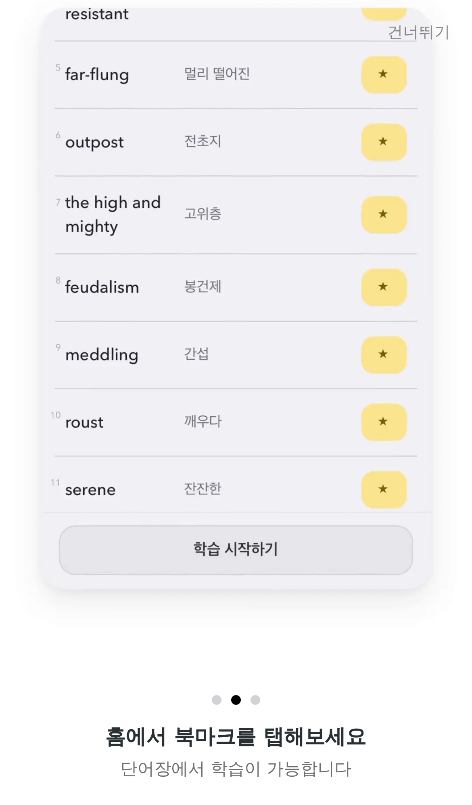
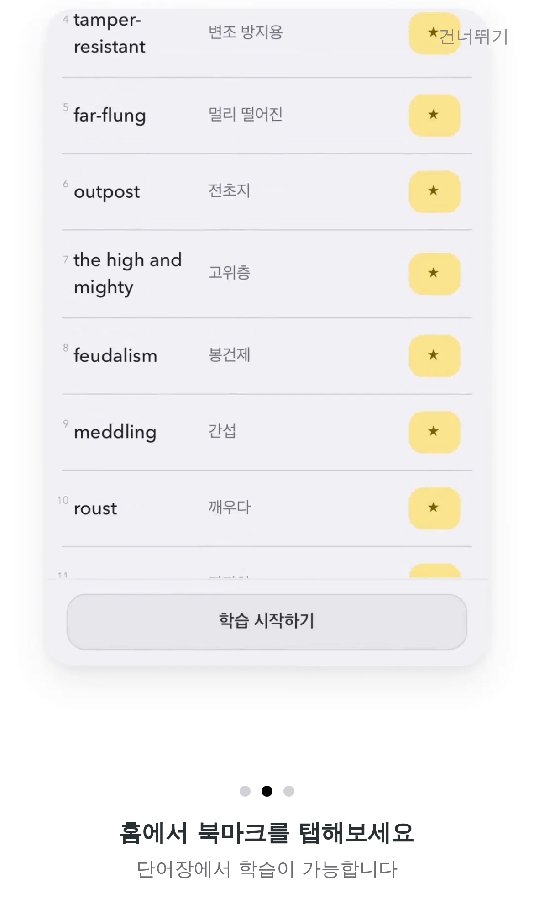

# Onboarding cards as 60fps animated WebP (#296)

iPhone 13 profile (Playwright WebKit, 390×844 @3x), animation running, light
and dark app theme. The onboarding surface stays light in both themes.

| | Light | Dark |
|---|---|---|
| Card 1 |  |  |
| Card 2 |  |  |
| Card 3 |  |  |

## Sizes (bytes)

| File | Before (H264 MP4) | After (animated WebP) |
|---|---:|---:|
| card1 (1080×1920) | 1,802,115 | 9,510,850 |
| card1-wide (1440×1080) | 1,850,899 | 7,638,120 |
| card2 (1080×1920) | 808,982 | 4,138,942 |
| card2-wide (1440×1080) | 817,087 | 2,338,372 |

A phone loads card1 + card2: 2.6 MB before, 13.6 MB after. The still JPEGs
(reduced motion) are unchanged. Encoded by `tools/encode-onboarding-webp.sh`
(lossy q75, key frame every 3 frames; see docs/decisions/006-reader-onboarding.md).
